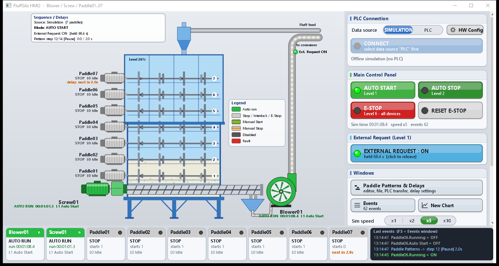
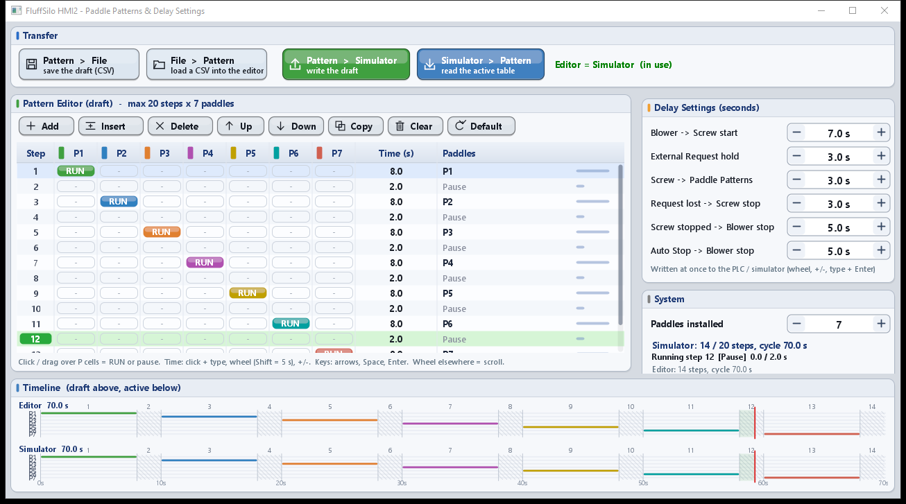
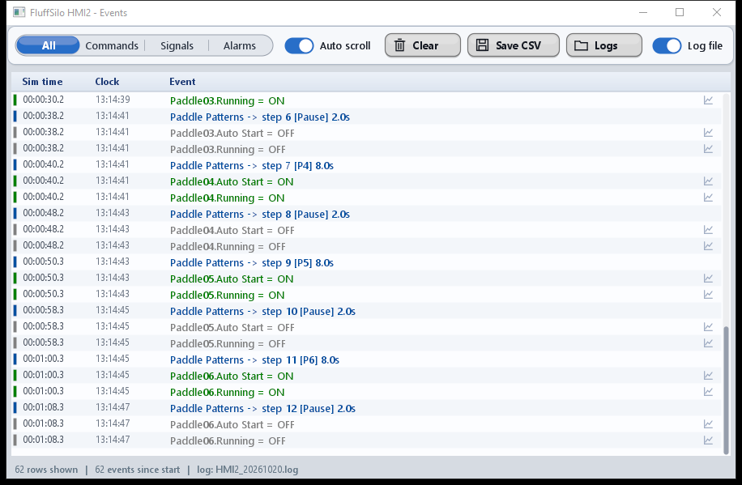
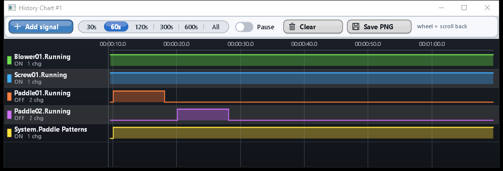
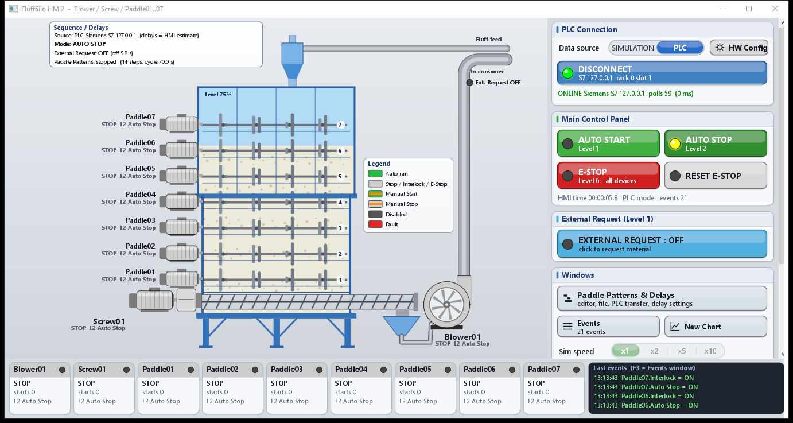

# FluffSilo HMI2

HMI รุ่นที่ 2 ของ Fluff Silo System สร้างต่อจาก `FluffSiloHMI`

- รองรับ **Paddle ได้ถึง 7 ตัว** (Paddle01..07) รวมเป็น 9 อุปกรณ์ (Blower01, Screw01, Paddle01..07)
  - ตั้งจำนวน Paddle ที่ติดตั้งจริงได้ 1..7 ตัว ตัวที่ไม่ได้ติดตั้งจะถูกซ่อนและไม่ทำงาน
- **Paddle Patterns ได้ถึง 20 Step**
- หน้าจอทั้งหมดวาดด้วย **BGRABitmap** (ปุ่ม, การ์ด, ช่องตัวเลข, สวิตช์, ตาราง Pattern, Timeline, Event log, Chart)
- ทำงานได้ 2 แบบ: **Simulation** (จำลองในเครื่อง) หรือ **PLC** (Modbus TCP / Siemens S7)
- ใช้คู่กับโปรแกรม PLC ใน [`../PLC2_S7-1200`](../PLC2_S7-1200/README.md)



---

## 1. หน้าต่างทั้งหมด

| หน้าต่าง | เปิดจาก | เนื้อหา |
|---|---|---|
| **Main** | — | Overview ของเครื่อง (Paddle ตามจำนวนที่ติดตั้ง), แถบสถานะอุปกรณ์ด้านล่าง + เหตุการณ์ล่าสุด, ด้านขวา: PLC Connection, Main Control Panel, External Request, Windows, Paddle Patterns (live) |
| **Paddle Patterns & Delay Settings** | ปุ่ม *Paddle Patterns & Delays*, คลิกการ์ด *Paddle Patterns (live)* หรือ **F2** | ตัวแก้ไข Pattern (draft), ปุ่มโอนข้อมูล 4 แบบ, Delay Settings, จำนวน Paddle ที่ติดตั้ง, Timeline |
| **Events** | ปุ่ม *Events*, คลิกกล่อง *Last events* หรือ **F3** | Event log ทั้งหมด (กรองได้), Save CSV, เปิดโฟลเดอร์ log |
| **History Chart** | ปุ่ม *New Chart*, **F4**, *Chart all* ในหน้าอุปกรณ์ | กราฟ history ของสัญญาณ (เพิ่มได้หลาย chart) |
| **Device panel** | คลิกอุปกรณ์ใน Overview หรือที่แถบสถานะด้านล่าง | Manual Start/Stop, Return to Auto, Enable/Disable, Reset Fault, Simulate Fault (เฉพาะ Simulation), สถานะ 10 property |
| **Hardware Config** | ปุ่ม *HW Config* | Protocol, IP, Rack/Slot, register map (แก้ address ได้ทุก tag) — ใช้หน้าต่างชุดเดียวกับ HMI1 |

### 1.1 Paddle Patterns & Delay Settings



ตัวแก้ไขทำงานกับ **สำเนา (draft)** ของ Pattern การแก้ไขในตารางจะยังไม่ส่งไป PLC จนกว่าจะกดปุ่มโอนข้อมูล

| ปุ่ม | ทำอะไร |
|---|---|
| **Pattern > File** | บันทึก draft เป็นไฟล์ CSV (ค่าเริ่มต้นโฟลเดอร์ `patterns\`) |
| **File > Pattern** | โหลดไฟล์ CSV เข้า draft (PLC ยังไม่เปลี่ยน) |
| **Pattern > PLC** | เขียน draft ลง PLC โดยส่ง**เฉพาะ step ที่เปลี่ยน** ถ้าจำนวน step ลดลงจะลด StepCount ก่อนเพื่อไม่ให้ PLC วิ่งตารางที่เขียนไม่เสร็จ |
| **PLC > Pattern** | คัดลอกตารางที่ใช้งานอยู่ใน PLC มาไว้ใน draft |

- ในโหมด Simulation ปุ่มจะเปลี่ยนชื่อเป็น *Pattern > Simulator* / *Simulator > Pattern*
- ข้อความสถานะด้านขวา: **Editor = PLC (in use)** สีเขียว = draft ตรงกับ PLC, **Editor modified** สีส้ม = ยังไม่ได้ส่ง
- ถ้า Paddle Patterns กำลังทำงานอยู่ จะถามยืนยันก่อนส่ง
- ถ้า draft มีการใช้ Paddle ที่ไม่ได้ติดตั้ง จะเตือนก่อน (PLC จะตัด bit เหล่านั้นทิ้ง)

การแก้ไขตาราง:

| การกระทำ | ผล |
|---|---|
| หมุนล้อเมาส์ | เลื่อนตารางขึ้น/ลง (ครบ 20 บรรทัด รวมบรรทัดว่าง) |
| คลิกช่อง P1..P7 | สลับ RUN / pause (ลากเมาส์ต่อไปบนช่องอื่นได้ จะใส่ค่าเดียวกัน) |
| คลิกช่อง Time แล้วพิมพ์ตัวเลข + Enter | ตั้งเวลา (0.5..600.0 s) |
| **Ctrl** + หมุนล้อเมาส์บนช่อง Time | ±0.5 s (Ctrl + Shift = ±5 s) |
| ปุ่มลูกศร, Home/End, Space, Enter, +/− | ใช้คีย์บอร์ดแทนเมาส์ได้ เลื่อนได้ถึงบรรทัด 20 |
| แก้ไขบรรทัดว่าง (คลิก P หรือพิมพ์เวลา) | เพิ่ม step จนถึงบรรทัดนั้นให้อัตโนมัติ (step ที่เพิ่มเป็นพัก 5 s) |
| Add / Insert / Delete / Up / Down / Copy / Clear / Default | จัดการ step (สูงสุด 20) — *Default* = แต่ละ Paddle 8 s + พัก 2 s |

**Delay Settings** (6 ค่า) และ **Paddles installed** เขียนลง PLC/Simulator ทันทีที่เปลี่ยน (เหมือน HMI1)
ค่าที่แสดงอ่านกลับจาก PLC ทุกรอบ poll

**Timeline** ด้านล่าง: แถวบน = draft, แถวล่าง = Pattern ที่ใช้งานจริง พร้อมเส้นแดงบอกตำแหน่งที่กำลังทำงาน

### 1.2 Events



- กรอง: **All / Commands / Signals / Alarms**
- **Auto scroll**: เลื่อนขึ้นเองจะหยุด auto scroll และเลื่อนลงจนสุดจะเริ่มใหม่
- ลากเหตุการณ์ที่เป็นสัญญาณไปวางบน Chart ได้ หรือ double-click เพื่อเปิด Chart ใหม่ของสัญญาณนั้น
- **Clear** ล้างเฉพาะรายการบนจอ (ไฟล์ log ยังเก็บครบ)
- **Save CSV** บันทึกรายการที่แสดงอยู่ (ตามตัวกรอง)
- **Log file** เปิด/ปิดการเขียนไฟล์ `logs\HMI2_yyyymmdd.log` (วันละไฟล์) — **Logs** เปิดโฟลเดอร์

### 1.3 History Chart



- **Add signal** เลือกสัญญาณจากเมนู (System, หรืออุปกรณ์ → property หรือ *All properties*) แสดงเฉพาะอุปกรณ์ที่ติดตั้ง
- ช่วงเวลา 30 s .. 600 s / All, **Pause**, หมุนล้อเมาส์ = ย้อนดูอดีต, double-click ที่แถว = ลบ trace
- **Save PNG** บันทึกรูปกราฟ
- กลุ่ม *Signals (drag to chart)* ของ HMI1 ถูกตัดออกตามที่กำหนด — เพิ่มสัญญาณผ่าน *Add signal*, การลากจาก Events หรือจากหน้าอุปกรณ์แทน

---

## 2. การใช้งานกับ PLC

1. กด **HW Config** → เลือก Protocol (**Siemens S7** สำหรับ `PLC2_S7-1200`), IP, Port 102, Rack 0 / Slot 1 → **Apply & Close**
2. Data source = **PLC** → **CONNECT**
3. เปิดหน้าต่าง Paddle Patterns จะเห็นตารางที่อ่านจาก PLC ทันที

ค่าเริ่มต้นของ register map อยู่ใน [`docs/HMI2_RegisterMap.md`](docs/HMI2_RegisterMap.md)
และไฟล์ [`docs/RegisterMap_Default.csv`](docs/RegisterMap_Default.csv) (Import ได้ใน HW Config)



---

## 3. ทดสอบโดยไม่มี PLC (PLC emulator)

```bash
python -I tools/plc_emulator2.py --port 5020 --s7port 1102
```

- Modbus TCP ที่ port 5020, Siemens S7 (DB10) ที่ port 1102
- emulator อ่าน register map จาก `docs/RegisterMap_Default.csv` จึงตรงกับ HMI2 เสมอ
- ใน HMI2: HW Config → IP `127.0.0.1` port `1102` (S7) หรือ `5020` (Modbus) → Apply & Close → Data source PLC → CONNECT

ทดสอบอัตโนมัติ (console, ไม่มีหน้าจอ):

```bash
fpc -Mobjfpc -Sh -Fu.. tools/linktest2.lpr
```

แล้วรัน `linktest2 s7 127.0.0.1 1102` หรือ `linktest2 modbus 127.0.0.1 5020` ขณะ emulator ทำงาน

---

## 4. Command line

| Option | ผล |
|---|---|
| `--export-map <file.csv>` | เขียน register map ค่าเริ่มต้นลงไฟล์แล้วปิดโปรแกรม (ใช้สร้าง `docs/RegisterMap_Default.csv`) |
| `--open-all` | เปิดหน้าต่าง Pattern, Events และ Chart ตั้งแต่เริ่ม |
| `--demo` | (Simulation) ความเร็ว x5 + Auto Start + External Request อัตโนมัติ สำหรับสาธิต |

---

## 5. ไฟล์และโฟลเดอร์

| ไฟล์ / โฟลเดอร์ | หน้าที่ |
|---|---|
| `FluffSiloHMI2.lpi / .lpr` | โปรเจกต์ Lazarus |
| `umain.pas` | หน้าต่างหลัก: Overview (BGRABitmap), แถบสถานะ, การ์ดด้านขวา |
| `upatternform.pas` | หน้าต่าง Paddle Patterns & Delay Settings (`TPatternGrid`, Timeline, การโอนข้อมูล) |
| `ueventsform.pas` | หน้าต่าง Events (`TEventView`) |
| `uchartform.pas` | History Chart |
| `udeviceform.pas` | หน้าต่างควบคุมอุปกรณ์ |
| `uhwconfigform.pas` | Hardware Config (ชุดเดียวกับ HMI1) |
| `usim.pas` | Simulation engine + ฟังก์ชัน Pattern (CSV, mask) |
| `uplclink.pas` | PLC link (thread), default register map, การส่งคำสั่ง Hmi* |
| `ulog.pas` | เขียนไฟล์ log รายวัน, export CSV |
| `uwidgets.pas`, `udraw.pas` | ชุด widget และฟังก์ชันวาด BGRABitmap (theme, icon) |
| `umodbus.pas`, `us7.pas` | Modbus TCP / S7 client (ชุดเดียวกับ HMI1) |
| `FluffSiloHMI2.ini` | สร้างข้างไฟล์ .exe เมื่อบันทึก/ปิดโปรแกรม: การตั้งค่า PLC, register map, `[HMI]` |
| `patterns\` | ไฟล์ Pattern ตัวอย่าง: `Default_7Paddles`, `Default_3Paddles`, `Pairs_7Paddles`, `Wave_20Steps` |
| `logs\` | ไฟล์ event log รายวัน (สร้างอัตโนมัติ) |
| `tools\plc_emulator2.py` | PLC emulator (Modbus + S7) |
| `tools\linktest2.lpr` | ทดสอบ PLC link อัตโนมัติ |
| `docs\` | Register map, คู่มือนักพัฒนา, ภาพหน้าจอ |

ข้อมูลสำหรับพัฒนาต่ออยู่ใน [`docs/DEVELOPMENT.md`](docs/DEVELOPMENT.md)

---

## 6. การ Build

- Lazarus (ทดสอบกับ lazbuild ที่ `C:\lazarus`, FPC 3.2.2) + แพ็กเกจ **BGRABitmap**
- เปิด `FluffSiloHMI2.lpi` แล้ว Build หรือ `lazbuild FluffSiloHMI2.lpi`

---

## 7. สิ่งที่ทดสอบแล้ว / ยังไม่ได้ทดสอบ

**ทดสอบแล้ว (เครื่องนี้)**
- Build ผ่าน ไม่มี warning ในหน่วยที่เขียนใหม่
- `linktest2` กับ `plc_emulator2.py` ผ่านทุกข้อ **ทั้ง Modbus และ S7**: อ่านค่า, Pattern > PLC 20 step และลดเหลือ 5 step แล้วอ่านกลับตรงกัน, ส่งซ้ำแล้วส่งเฉพาะค่าที่เปลี่ยน, Paddles installed 4 → 7, Auto Start + External Request จน Paddle Patterns ทำงาน, คำสั่งอุปกรณ์ Paddle07, E-Stop / Reset, ไฟล์ Pattern CSV 20 step
- เปิดหน้าจอจริงทั้งโหมด Simulation (`--open-all --demo`) และโหมด PLC (S7 ผ่าน emulator) แล้วตรวจภาพหน้าจอ
- ไฟล์ Pattern ตัวอย่างทั้ง 4 ไฟล์โหลดได้

**ยังไม่ได้ทดสอบ**
- กับ PLC จริง / PLCSIM (โปรแกรม `PLC2_S7-1200` ยังไม่ได้ compile ใน TIA Portal)
- การคลิกทุกปุ่มด้วยมือ (ทดสอบผ่านภาพหน้าจอและ link test เท่านั้น)
- จอที่ทดสอบคือ 1366×768 หน้าต่าง Pattern ถูกออกแบบให้เลื่อนตารางได้เมื่อจอเตี้ย
