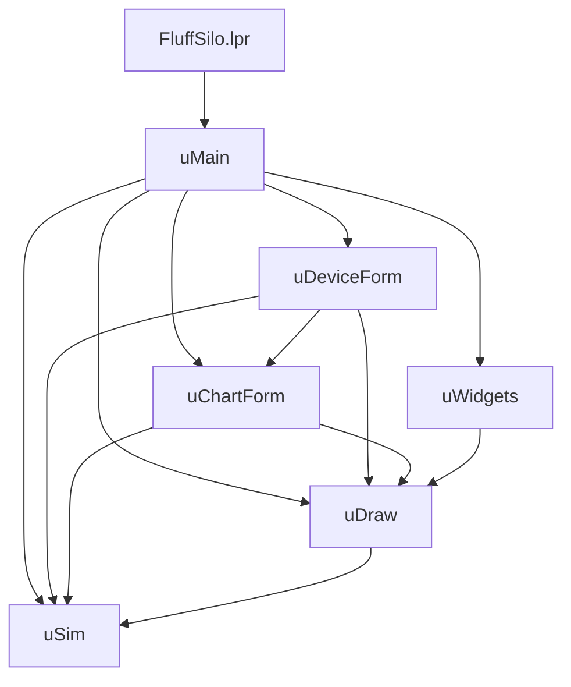
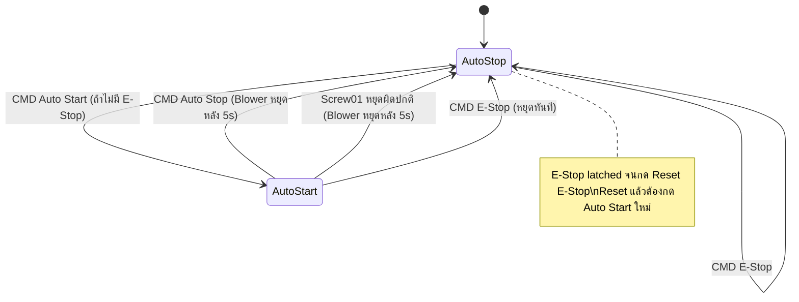
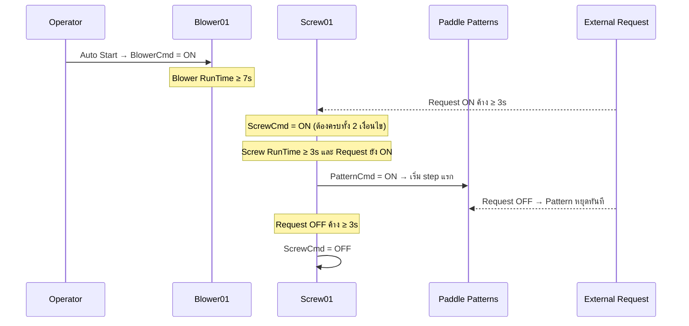
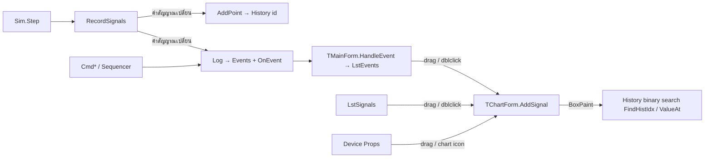

# Fluff Silo System — เอกสารวิเคราะห์ระบบ (System Analysis)

> จัดทำจากการอ่าน `Concept.txt`, รูป `OverViewFluffSiloSystem.jpg`, `FluffSiloControl.png` และซอร์สโค้ด Lazarus ทั้งหมดในโฟลเดอร์
> วันที่วิเคราะห์: 2026-10-17
> สถานะโปรแกรม: **Simulator** (จำลองการทำงาน ยังไม่เชื่อมต่อ I/O จริง)

---

## สารบัญ

1. [ภาพรวมระบบ](#1-ภาพรวมระบบ)
2. [โครงสร้างโปรเจกต์และไฟล์](#2-โครงสร้างโปรเจกต์และไฟล์)
3. [สถาปัตยกรรมซอฟต์แวร์](#3-สถาปัตยกรรมซอฟต์แวร์)
4. [แบบจำลองข้อมูล (Data Model)](#4-แบบจำลองข้อมูล-data-model)
5. [ระบบลำดับความสำคัญ (Priority Level)](#5-ระบบลำดับความสำคัญ-priority-level)
6. [Auto Sequencer — ลำดับการทำงานอัตโนมัติ](#6-auto-sequencer--ลำดับการทำงานอัตโนมัติ)
7. [Paddle Patterns](#7-paddle-patterns)
8. [Interlock และเหตุการณ์ผิดปกติ](#8-interlock-และเหตุการณ์ผิดปกติ)
9. [การแสดงผลสี (Visual State)](#9-การแสดงผลสี-visual-state)
10. [ส่วนติดต่อผู้ใช้ (UI)](#10-ส่วนติดต่อผู้ใช้-ui)
11. [Event Log, Signal History และ Chart](#11-event-log-signal-history-และ-chart)
12. [รอบการทำงานของ Timer (Main Loop)](#12-รอบการทำงานของ-timer-main-loop)
13. [ตาราง Traceability: Concept ↔ Code](#13-ตาราง-traceability-concept--code)
14. [ข้อสังเกต / ความเสี่ยง / จุดที่ควรแก้](#14-ข้อสังเกต--ความเสี่ยง--จุดที่ควรแก้)
15. [แนวทางพัฒนาต่อ (Roadmap)](#15-แนวทางพัฒนาต่อ-roadmap)
16. [คู่มือสำหรับนักพัฒนา (Where to change what)](#16-คู่มือสำหรับนักพัฒนา-where-to-change-what)

---

## 1. ภาพรวมระบบ

Fluff Silo คือไซโลเก็บวัตถุดิบประเภท Fluff (เส้นใยฟู) ประกอบด้วย

| อุปกรณ์ | หน้าที่ทางกายภาพ (ตามรูป Overview) |
|---|---|
| **Blower01** | พัดลมลำเลียงลม ดูดวัตถุดิบจาก Hopper ส่งตามท่อไปยังเครื่องปลายทาง (consumer) |
| **Screw01** | สกรูลำเลียงที่ฐานไซโล ดึงวัตถุดิบออกจากไซโลลง Hopper ของ Blower |
| **Paddle01 / 02 / 03** | ใบกวนภายในไซโล 3 ระดับ (01 ล่างสุด → 03 บนสุด) ป้องกันวัตถุดิบจับตัว/โก่งตัว (bridging) |

การไหลของวัตถุดิบ:

```
Fluff feed ──► Cyclone ──► Silo (Paddle01..03 กวน) ──► Screw01 ──► Hopper ──► Blower01 ──► to consumer
```

สัญญาณภายนอก **External Request** (Level 1) = สัญญาณร้องขอวัตถุดิบ เมื่อมีสัญญาณ ระบบจะปล่อยวัตถุดิบออกด้วย Screw01 + Paddle Patterns
(ในโค้ดตีความเป็น “ปลายทางต้องการวัตถุดิบ” — ดูข้อสังเกตข้อ 14.1)

---

## 2. โครงสร้างโปรเจกต์และไฟล์

| ไฟล์ | บรรทัดโดยประมาณ | หน้าที่ |
|---|---|---|
| [FluffSilo.lpr](FluffSilo.lpr) | 20 | Program entry — สร้าง `TMainForm` แล้ว `Application.Run` |
| [FluffSilo.lpi](FluffSilo.lpi) | — | Project file (Lazarus) ต้องการแพ็กเกจ **LCL + BGRABitmapPack**, มี Build Mode `Default` และ `Release` (O3, strip) |
| [usim.pas](usim.pas) | 875 | **Simulation Engine** — อุปกรณ์, Properties, Priority, Auto sequencer, Paddle Patterns, History, Event log (ไม่มีโค้ด UI) |
| [umain.pas](umain.pas) | 1078 | หน้าต่างหลัก — Overview (วาดด้วย BGRABitmap), Main Control Panel, External Request, Pattern editor, Delay settings, Event Log, Signal list |
| [udeviceform.pas](udeviceform.pas) | 279 | Popup Panel ควบคุมย่อย + Properties ของแต่ละอุปกรณ์ |
| [uchartform.pas](uchartform.pas) | 439 | Popup History Chart (รับ Drag & Drop สัญญาณ) |
| [udraw.pas](udraw.pas) | 346 | ฟังก์ชันวาดกลาง (พิกัด design → หน้าจอ), สีตามสถานะ, วาด Motor / GearMotor / Blower / LED |
| [uwidgets.pas](uwidgets.pas) | 124 | `TSimButton` ปุ่มกดพร้อมหลอดไฟสถานะ |
| [umain.lfm](umain.lfm) | 10 | Form resource ว่าง (UI ทั้งหมดสร้างด้วยโค้ดใน `BuildUI`) |
| `FluffSilo.exe` | 4.6 MB | ไฟล์ที่ build แล้ว |
| `Concept.txt` | — | ข้อกำหนดความต้องการ |
| `OverViewFluffSiloSystem.jpg` | — | ภาพต้นแบบหน้าจอ Overview |
| `FluffSiloControl.png` | — | ผังการเชื่อมสัญญาณควบคุม (Auto Start/Stop, E-Stop, External Request → อุปกรณ์) |

Dependency ระหว่าง Unit:



`uSim` ไม่พึ่ง unit ใดของ UI → สามารถนำไปใช้กับ backend จริง (PLC / I/O) ได้โดยแยกส่วน

---

## 3. สถาปัตยกรรมซอฟต์แวร์

```
┌──────────────────────────── UI Layer (LCL + BGRABitmap) ────────────────────────────┐
│ TMainForm (umain)        TDeviceForm x5 (udeviceform)      TChartForm xN (uchartform)│
│  - Overview PaintBox      - Icon + สถานะ                    - Waveform หลาย lane     │
│  - Main Control Panel     - 10 Properties (LED)             - Drag&Drop / Pause      │
│  - External Request       - ปุ่ม Manual/Enable/Fault        - Scroll ย้อนเวลา        │
│  - Pattern Grid / Delays                                                            │
│  - Event Log / Signals                                                              │
└───────────────▲─────────────────────────────┬────────────────────────────────────────┘
                │ อ่านสถานะ (polling ทุก 40ms)   │ คำสั่ง Cmd*()
                │ OnEvent callback              ▼
┌──────────────────────────── Engine Layer (usim) ────────────────────────────────────┐
│ TFluffSim (global var Sim)                                                          │
│  Step(dt) : Auto sequencer → RunPattern → map ไป Props → EvaluateDevice → Trip      │
│             → material model → RecordSignals (History + Event)                       │
│ TDevice x5 : Props[0..9], RunTime, TotalRunTime, StartCount, CtrlLevel, Reason      │
└─────────────────────────────────────────────────────────────────────────────────────┘
```

- **Global singleton**: `Sim: TFluffSim` ([usim.pas:180](usim.pas:180)) ใช้ร่วมทุกฟอร์ม
- **Global drag state**: `GDragSignal` ([usim.pas:181](usim.pas:181)) เก็บ id สัญญาณที่กำลังลากไป Chart
- เวลาในระบบเป็น **Sim time** (วินาที, Double) ไม่ใช่เวลาจริง → รองรับเร่งความเร็ว x1/x2/x5/x10

---

## 4. แบบจำลองข้อมูล (Data Model)

### 4.1 อุปกรณ์ (`DEV_*`)

| Index | ค่าคงที่ | ชื่อ |
|---|---|---|
| 0 | `DEV_BLOWER` | Blower01 |
| 1 | `DEV_SCREW` | Screw01 |
| 2 | `DEV_PADDLE1` | Paddle01 |
| 3 | `DEV_PADDLE2` | Paddle02 |
| 4 | `DEV_PADDLE3` | Paddle03 |

### 4.2 Properties ต่ออุปกรณ์ (`P_*`) — 9 คุณสมบัติตาม Concept + 1 Feedback

| Index | ค่าคงที่ | ชื่อ | Level | ผู้สั่ง |
|---|---|---|---|---|
| 0 | `P_AUTOSTART` | Auto Start | 1 | Auto sequencer / Pattern |
| 1 | `P_AUTOSTOP` | Auto Stop | 2 | Auto sequencer |
| 2 | `P_INTERLOCK` | Interlock | 2 | Engine (เงื่อนไขอุปกรณ์ต้นทาง) |
| 3 | `P_MANSTART` | Manual Start | 3 | ผู้ใช้ (Device panel) — latch |
| 4 | `P_MANSTOP` | Manual Stop | 4 | ผู้ใช้ (Device panel) — latch |
| 5 | `P_ENABLE` | Enable | 5 | = `not Disable` (derived) |
| 6 | `P_DISABLE` | Disable | 5 | ผู้ใช้ (Device panel) |
| 7 | `P_FAULT` | Fault | 6 | จำลองด้วยปุ่ม Simulate Fault |
| 8 | `P_ESTOP` | E-Stop | 6 | = E-Stop Main |
| 9 | `P_RUNNING` | Running | 0 (Feedback) | ผลลัพธ์จาก `EvaluateDevice` |

### 4.3 สัญญาณระบบ (`SYS_*`)

| Id | ชื่อ | ที่มา |
|---|---|---|
| `SYS_BASE+0` | System.External Request | `Sim.ExtRequest` |
| `SYS_BASE+1` | System.Auto Mode | `Mode = smAutoStart` |
| `SYS_BASE+2` | System.Paddle Patterns | `Sim.PatternActive` |
| `SYS_BASE+3` | System.E-Stop (Main) | `Sim.EStopMain` |

**Signal Id** = `Dev * 10 + Prop` (0..49) และ `50..53` สำหรับสัญญาณระบบ → รวม `SIGNAL_COUNT = 54` สัญญาณ ทุกตัวถูกบันทึก History

### 4.4 ตัวแปรสถานะหลักของ `TFluffSim`

| ตัวแปร | ความหมาย |
|---|---|
| `Mode` | `smAutoStop` / `smAutoStart` |
| `ExtRequest`, `ReqOnTime`, `ReqOffTime` | สถานะคำร้องขอ + ระยะเวลาที่ค้าง ON/OFF |
| `EStopMain` | E-Stop หลัก (latched จนกด Reset) |
| `BlowerCmd`, `ScrewCmd`, `PatternCmd` | คำสั่ง Auto ภายใน (ยังไม่ใช่ output จริง) |
| `PatternActive`, `PatStep`, `PatElapsed` | สถานะ Paddle Patterns |
| `BlowerStopTimer` | ตัวนับถอยหลังก่อนหยุด Blower (>0 = กำลังนับ) |
| `SiloLevel`, `Filling` | โมเดลระดับวัตถุดิบ (ใช้แสดงผลเท่านั้น) |
| `History[]`, `Events[]` | ประวัติสัญญาณ / เหตุการณ์ |

### 4.5 ค่าหน่วงเวลา (ปรับได้จาก UI “Delay Settings”)

| ตัวแปร | ค่าเริ่มต้น | ความหมาย | ที่มาใน Concept |
|---|---|---|---|
| `TBlowerToScrew` | 7 s | Blower ทำงานครบ → อนุญาต Screw | “หลังจาก 7 วินาที” |
| `TReqHold` | 3 s | External Request ต้องค้างนานเกิน | “ร้องขอนานเกิน 3 วินาที” |
| `TScrewToPaddle` | 3 s | Screw ทำงานครบ → Paddle Patterns เริ่ม | “หลังจาก 3 วินาที Paddle Patterns เริ่ม” |
| `TReqOffScrewStop` | 3 s | Request หาย → Screw หยุด | “หลังจาก 3 วินาที Screw01 จะหยุด” |
| `TScrewTripBlower` | 5 s | Screw หยุดผิดปกติ → Blower หยุด | “หลังจาก 5 วินาที Blower01 หยุด” |
| `TAutoStopBlower` | 5 s | กด Auto Stop → Blower หยุด | “หลังจาก 5 วินาที Blower01 จะหยุด” |

---

## 5. ระบบลำดับความสำคัญ (Priority Level)

หลักการ: **Level สูงกว่าชนะเสมอ** — ประเมินใน `EvaluateDevice` ([usim.pas:379](usim.pas:379)) ตามลำดับ:

```
Fault (6) ─► E-Stop (6) ─► Disable (5) ─► Manual Stop (4) ─► Manual Start (3)
   ─► Auto Stop (2) ─► Interlock (2) ─► Auto Start (1) ─► Idle (0)
```

| เงื่อนไขแรกที่เป็นจริง | Running | CtrlLevel | Reason |
|---|---|---|---|
| Fault | OFF | 6 | Fault |
| E-Stop | OFF | 6 | E-Stop |
| Disable | OFF | 5 | Disabled |
| Manual Stop | OFF | 4 | Manual Stop |
| Manual Start | **ON** | 3 | Manual Start |
| Auto Stop | OFF | 2 | Auto Stop |
| Interlock | OFF | 2 | Interlock |
| Auto Start | **ON** | 1 | Auto Start |
| (ไม่มี) | OFF | 0 | Idle |

ผลข้างเคียงที่สำคัญ: **Manual Start (L3) ชนะ Interlock (L2) และ Auto Stop (L2)** → ผู้ใช้สามารถสั่ง Screw/Paddle วิ่งได้แม้ Blower/Screw ไม่ทำงาน (ตรงกับกฎ Level ใน Concept แต่ควรพิจารณาด้านความปลอดภัย ดูข้อ 14)

นอกจากนี้ `EvaluateDevice` ยังนับ `RunTime` (รีเซ็ตเมื่อหยุด), `TotalRunTime`, `StartCount` (นับขอบขาขึ้น) และ `Phase` สำหรับแอนิเมชัน

---

## 6. Auto Sequencer — ลำดับการทำงานอัตโนมัติ

โค้ดหลัก: `TFluffSim.Step` ([usim.pas:514](usim.pas:514))

### 6.1 State Diagram ระดับระบบ



### 6.2 ลำดับใน Mode Auto Start



กฎทั้งหมดในโหมด `smAutoStart` (ประเมินทุก step):

1. `BlowerCmd := True`, ยกเลิก `BlowerStopTimer`
2. ถ้า Blower **ไม่ได้ทำงาน** (ด้วยเหตุใดก็ตาม) → `ScrewCmd := False` (และ Pattern หยุดตามข้อ 5)
3. ถ้า Blower ทำงานอยู่:
   - เริ่ม Screw เมื่อ `ExtRequest` และ `Blower.RunTime ≥ TBlowerToScrew` และ `ReqOnTime ≥ TReqHold`
   - หยุด Screw เมื่อ `not ExtRequest` และ `ReqOffTime ≥ TReqOffScrewStop`
4. `PatternCmd := ScrewCmd and screwRun and blowerRun and ExtRequest and Screw.RunTime ≥ TScrewToPaddle`
   → **Request หาย = Pattern หยุดทันที** (ไม่มีหน่วง)

### 6.3 Mode Auto Stop

- `ScrewCmd := False`, `PatternCmd := False` ทันที
- ถ้า `BlowerStopTimer > 0` นับถอยหลัง → ครบแล้ว `BlowerCmd := False`
- External Request ใน Auto Stop **ไม่สั่งการใด ๆ** (เพียง log ว่า “ignored”) — ตรง Concept

### 6.4 การแปลงคำสั่ง Auto → Properties ([usim.pas:586-611](usim.pas:586))

| อุปกรณ์ | Auto Start | Auto Stop | Interlock |
|---|---|---|---|
| Blower01 | `BlowerCmd` | `Mode=AutoStop and not BlowerCmd` | ไม่มี (False) |
| Screw01 | `ScrewCmd` | `Mode=AutoStop` | `not Blower.Running` |
| PaddleN | `PatternActive and Pattern[PatStep].P[N]` | `Mode=AutoStop` | `not Screw.Running` |
| ทุกตัว | — | — | `E-Stop := EStopMain`, `Enable := not Disable` |

### 6.5 คำสั่งจาก Main Panel ([usim.pas:648-697](usim.pas:648))

| คำสั่ง | ผล |
|---|---|
| `CmdAutoStart` | ถูกปฏิเสธถ้า E-Stop active; มิฉะนั้น `Mode := smAutoStart` |
| `CmdAutoStop` | ถ้าอยู่ Auto Start → `Mode := smAutoStop`, หยุด Screw/Pattern, ตั้ง `BlowerStopTimer := TAutoStopBlower` (ถ้า Blower ถูกสั่งอยู่) |
| `CmdEStop` | `EStopMain := True`, Mode → Auto Stop, ล้างทุกคำสั่งทันที (ไม่มีหน่วง) |
| `CmdResetEStop` | `EStopMain := False` (ไม่ restart อัตโนมัติ) |
| `SetExtRequest(V)` | เปลี่ยนสถานะ Request (toggle จากปุ่ม) |

### 6.6 คำสั่งจาก Device Panel ([usim.pas:699-745](usim.pas:699))

| ปุ่ม | ผล |
|---|---|
| Manual Start | `MANSTART := True`, `MANSTOP := False` (latch) |
| Manual Stop | `MANSTOP := True`, `MANSTART := False` (latch) |
| Return to Auto | ล้างทั้ง MANSTART/MANSTOP |
| Enable / Disable | สลับ `DISABLE` / `ENABLE` |
| Simulate Fault / Reset Fault | ตั้ง/ล้าง `FAULT` |
| Chart all | เปิด Chart ทุก Property ของอุปกรณ์นั้น |

---

## 7. Paddle Patterns

โค้ด: `RunPattern` ([usim.pas:480](usim.pas:480)), `FindNextStep` ([usim.pas:439](usim.pas:439)), `StepBlocked` ([usim.pas:426](usim.pas:426))

### 7.1 โครงสร้าง

```pascal
TPatternStep = record
  P: array[0..2] of Boolean;   // Paddle01..03 ทำงานใน step นี้หรือไม่
  Duration: Double;            // วินาที (ขั้นต่ำ 0.5)
end;
Pattern: array of TPatternStep; // วนลูปตามลำดับ
```

Step ที่ไม่มี Paddle ใดเลย = **Pause** (ใช้ทำการหน่วงเวลาระหว่างสลับ)

### 7.2 Pattern เริ่มต้น (`LoadDefaultPattern`)

| Step | P1 | P2 | P3 | Time |
|---|---|---|---|---|
| 1 | RUN | - | - | 8 s |
| 2 | - | - | - | 2 s (Pause) |
| 3 | - | RUN | - | 8 s |
| 4 | - | - | - | 2 s (Pause) |
| 5 | - | - | RUN | 8 s |
| 6 | - | - | - | 2 s (Pause) |

### 7.3 อัลกอริทึม

1. `PatternCmd = False` หรือ Pattern ว่าง → `PatternActive := False` (Paddle Auto Start ดับทั้งหมด)
2. เริ่มใหม่ (ขอบขาขึ้น) → เริ่มจาก step แรกที่ไม่ถูก block
3. ทุก tick: `PatElapsed += dt`
   - ครบ `Duration` → ไป step ถัดไปที่ไม่ถูก block (วนรอบ)
   - ยังไม่ครบ แต่ step ปัจจุบัน **ถูก block** → ข้ามไป step ถัดไปที่มี Paddle ใช้งานได้ (ข้าม Pause) — ตอบโจทย์ Concept “Paddle ตัวใดหยุด Paddle ตัวถัดไปทำงานต่อ”
4. **Step ถูก block** = step ที่ต้องใช้ Paddle แต่ทุก Paddle ใน step นั้น `not Available` (Fault / E-Stop / Disable / Manual Stop)
   หมายเหตุ: Interlock ไม่ทำให้ block

### 7.4 การแก้ไข Pattern ระหว่างรัน (UI)

- คลิกช่อง P1/P2/P3 → toggle RUN
- แก้คอลัมน์ Time (ขั้นต่ำ 0.5 s)
- Add step / Delete step / Default
- Step ที่กำลังทำงานถูกไฮไลต์สีเขียวใน Grid

---

## 8. Interlock และเหตุการณ์ผิดปกติ

| เหตุการณ์ (Concept) | การทำงานในโค้ด | ผลลัพธ์ |
|---|---|---|
| Blower01 หยุด (Fault/Disable/Manual Stop/…) | `ScrewCmd := False` + Screw Interlock = ON | Screw และ Pattern หยุดทันที; **Mode ยังคง Auto Start** → เมื่อ Blower กลับมาได้ จะเริ่มลำดับใหม่อัตโนมัติ |
| Screw01 หยุดขณะ Auto ต้องการให้วิ่ง | ตรวจขอบลง [usim.pas:615](usim.pas:615) | Pattern หยุดทันที, **Mode → Auto Stop**, Blower หยุดหลัง `TScrewTripBlower` (5s) |
| Paddle ตัวหนึ่งหยุด | Paddle Interlock / StepBlocked | Pattern ข้ามไป Paddle ถัดไป |
| E-Stop | ทุกอุปกรณ์ E-Stop = ON (L6) | หยุดทั้งหมดทันที, Auto Start ถูกปฏิเสธจนกว่าจะ Reset |
| External Request หาย | `PatternCmd` เป็น False ทันที | Pattern หยุดทันที, Screw หยุดหลัง 3s |

---

## 9. การแสดงผลสี (Visual State)

`TDevice.Visual` ([usim.pas:239](usim.pas:239)) + `StateColor` ([udraw.pas:105](udraw.pas:105))

| ลำดับตรวจ | เงื่อนไข | `TDevVisual` | สี | ข้อความ |
|---|---|---|---|---|
| 1 | Fault | `dvFault` | แดง `(225,40,40)` | FAULT |
| 2 | Disable | `dvDisabled` | เทาเข้ม `(85,85,85)` | DISABLED |
| 3 | E-Stop | `dvIdle` | เทาอ่อน `(205,205,205)` | STOP |
| 4 | Manual Stop | `dvManualStop` | เทาอ่อน + **คาดส้ม** | MANUAL STOP |
| 5 | Manual Start | `dvManualRun` | เขียว + **คาดส้ม** | MANUAL RUN |
| 6 | Running (Auto) | `dvAutoRun` | เขียว `(40,185,70)` | AUTO RUN |
| 7 | อื่น ๆ (Auto Stop/Interlock/Idle) | `dvIdle` | เทาอ่อน | STOP |

ตรงกับ Concept ทุกข้อ แถบส้มวาดด้วย `DrawStripe` (Motor/GearMotor) หรือวงแหวนส้ม (Blower)

---

## 10. ส่วนติดต่อผู้ใช้ (UI)

### 10.1 หน้าต่างหลัก (`TMainForm`, 1500×940)

```
┌─────────────────────────────────────────────┬──────────────────────────────┐
│                                             │ Main Control Panel           │
│   OVERVIEW (PaintBox, BGRABitmap)           │  AUTO START | AUTO STOP      │
│   - Timing box "Sequence / Delays"          │  E-STOP     | RESET E-STOP   │
│   - Legend สี                                │  Sim time / speed / events   │
│   - Silo + ระดับวัตถุดิบ, Cyclone, ท่อ        ├──────────────────────────────┤
│   - Paddle01..03, Screw01, Blower01         │ External Request (toggle)    │
│     (คลิก = เปิด Device Panel)               ├──────────────────────────────┤
│   - ป้ายชื่อ/สถานะ/RunTime/Level/Delay        │ Paddle Patterns Grid         │
│   - แอนิเมชันการไหล (flow dots)              │  Add / Delete / Default      │
│   - แบนเนอร์ E-STOP ACTIVE                   ├──────────────────────────────┤
│                                             │ Delay Settings (6 ค่า)        │
│                                             ├──────────────────────────────┤
│                                             │ Simulation speed x1..x10     │
├─────────────────────────────────────────────┴──────────────────────────────┤
│ Event Log (สีตามประเภท, Auto scroll, Clear)   │ Signals (54 รายการ)          │
│ ลาก/ดับเบิลคลิก → Chart                       │ ลาก/ดับเบิลคลิก → Chart        │
└─────────────────────────────────────────────┴──────────────────────────────┘
```

- พิกัดวาดใช้ระบบ **design canvas 1000×740** แล้ว scale ให้พอดีกับ PaintBox (`SetView`, `VX/VY/VL`)
- พื้นที่คลิกอุปกรณ์ `FHit[]` กำหนดที่ [umain.pas:842](umain.pas:842)
- สีข้อความ Event Log: น้ำเงิน = คำสั่ง/sequencer, แดง = Fault/E-Stop ON, ส้ม = Manual ON, เขียว = ON, เทา = OFF

### 10.2 Device Panel (`TDeviceForm`, 1 หน้าต่างต่ออุปกรณ์, StayOnTop)

- ส่วนบน: ไอคอนอุปกรณ์ตามสี, ชื่อ, ป้ายสถานะ, `Control: L<n> <Reason>`, Run time, Total, Starts, Delay
- ตาราง 10 Properties: LED, ชื่อ, Level, ON/OFF, แถบน้ำเงินแสดง Level ที่กำลังควบคุม, ไอคอน chart (คลิก = เปิด chart), ลากไป chart ได้
- ปุ่ม 8 ปุ่ม (ดูข้อ 6.6)

### 10.3 History Chart (`TChartForm`, เปิดได้หลายหน้าต่าง)

- Lane ละสัญญาณ แสดงแบบ digital waveform (ON = แถบทึบด้านบน)
- ช่วงเวลา: 30 / 60 / 120 / 300 / 600 s / All
- Pause, Mouse wheel = เลื่อนย้อนเวลา (pause อัตโนมัติ), Crosshair แสดงเวลา + ค่าทุก lane
- Double-click lane = ลบ, Clear traces
- ป้ายแสดงค่าปัจจุบัน, Level, จำนวนครั้งที่เปลี่ยนสถานะ

---

## 11. Event Log, Signal History และ Chart



- History เก็บเฉพาะ **จุดที่ค่าเปลี่ยน** (edge-based) → ประหยัดหน่วยความจำ ค้นหาด้วย binary search
- Event ที่มาจาก sequencer ใช้ `Sig = -1` (ลากไป chart ไม่ได้)
- ใน ListBox เก็บ `(Sig, Value)` เข้ารหัสลงใน `TObject` (`EncodeEv`/`DecodeEv`) เพื่อไม่ต้องจองหน่วยความจำ
- LstEvents เก็บสูงสุด 3000 บรรทัด (แต่ `Sim.Events` ไม่มีเพดาน)

---

## 12. รอบการทำงานของ Timer (Main Loop)

`TMainForm.TimerTick` ([umain.pas:403](umain.pas:403)) — Timer 40 ms

1. คำนวณ `dt` จริง (clamp ≤ 0.25 s) × ความเร็ว simulation
2. แบ่ง `dt` เป็นช่วงย่อย ≤ 0.05 s แล้วเรียก `Sim.Step(d)` (ความละเอียดของเวลาหน่วงคงที่แม้เร่ง x10)
3. อัปเดตหลอดไฟปุ่ม, ข้อความ External Request, เวลา sim
4. จัดการ Event list (ตัดเหลือ 3000, auto scroll)
5. Invalidate Grid, Overview, Device forms, Charts

ลำดับภายใน `Sim.Step(dt)`:

```
Time += dt
→ อัปเดต ReqOnTime / ReqOffTime
→ Auto sequencer (ตาม Mode)
→ RunPattern
→ แปลงคำสั่ง → Props (Auto Start/Stop/Interlock/E-Stop/Enable)
→ EvaluateDevice ×5 (Blower → Screw → Paddle1..3)
→ ตรวจ Screw trip
→ โมเดลระดับไซโล
→ RecordSignals
```

---

## 13. ตาราง Traceability: Concept ↔ Code

| # | ข้อกำหนดใน Concept | สถานะ | ตำแหน่งโค้ด |
|---|---|---|---|
| 1 | Paddle Patterns สลับ/หยุด/หน่วงเวลา | ✅ | `RunPattern`, Grid ใน umain |
| 2 | External Request | ✅ | `SetExtRequest`, ปุ่ม BtnReq |
| 3 | อุปกรณ์ 5 ชิ้น | ✅ | `DEV_*` |
| 4 | 9 คุณสมบัติ + Level | ✅ (+Running feedback) | `P_*`, `PropLevels` |
| 5 | Level สูงกว่ามีสิทธิ์เหนือกว่า | ✅ | `EvaluateDevice` |
| 6 | Auto Start → Blower → 7s → Screw → 3s → Pattern | ✅ | `Step` smAutoStart |
| 7 | Request หาย → Pattern หยุดทันที, 3s → Screw หยุด | ✅ | `PatternCmd`, `TReqOffScrewStop` |
| 8 | Request ค้าง > 3s → Screw; Screw 3s → Pattern | ✅ | `TReqHold`, `TScrewToPaddle` |
| 9 | Blower หยุด → Screw, Pattern หยุดทันที | ✅ | `ScrewCmd := False` + Interlock |
| 10 | Screw หยุด → Pattern หยุดทันที, 5s → Blower หยุด | ✅ (เปลี่ยน Mode เป็น Auto Stop ด้วย) | [usim.pas:615](usim.pas:615) |
| 11 | Paddle ตัวหนึ่งหยุด → ตัวถัดไปทำงานต่อ | ✅ | `StepBlocked`, `FindNextStep(True)` |
| 12 | Auto Stop → Pattern+Screw หยุดทันที, 5s → Blower | ✅ | `CmdAutoStop` |
| 13 | Request ใน Auto Stop → ไม่สั่งการ | ✅ | `SetExtRequest` log ignored |
| 14 | Overview | ✅ | `DrawScene` |
| 15 | Panel ควบคุมรวม (Auto Start/Stop/E-Stop) | ✅ (+Reset E-Stop) | `BuildUI` |
| 16 | Panel External Request | ✅ | `BuildUI` |
| 17 | Popup Panel ควบคุมย่อย + Properties | ✅ | `TDeviceForm` |
| 18 | Popup Chart ของแต่ละ Property | ✅ | `TChartForm`, chart icon |
| 19 | สีอุปกรณ์ 6 แบบ | ✅ | `Visual`, `StateColor` |
| 20 | มองเห็นเวลาทำงาน / การหน่วงเวลา | ✅ | Timing box, `DevDelayText`, Device label |
| 21 | ทุกเหตุการณ์มองเห็น + ลากลง Chart ได้ | ✅ | Event Log / Signals / Device props drag |

**สรุป: ครอบคลุมข้อกำหนดใน Concept ครบทุกข้อ**

---

## 14. ข้อสังเกต / ความเสี่ยง / จุดที่ควรแก้

### 14.1 การตีความข้อกำหนด (ควรยืนยันกับผู้ใช้งาน)

1. **ความหมายของ External Request** — Concept เขียนว่า “ร้องขอเพื่อต้องการเติมวัตถุดิบ” แต่โค้ดใช้ Request เพื่อ *ปล่อยวัตถุดิบออก* ไปยังปลายทาง (Screw → Blower → consumer) ส่วนการเติมเข้าไซโล (`Filling`) เป็นโมเดลแสดงผลอัตโนมัติ (<25% เริ่มเติม, ถึง 90% หยุด) ไม่ผูกกับ Request — ควรยืนยันว่าเป็น “ปลายทางขอวัตถุดิบ” จริง
2. **Screw หยุดผิดปกติ → Mode เปลี่ยนเป็น Auto Stop** — Concept ไม่ได้ระบุ ผู้ควบคุมต้องกด Auto Start ใหม่หลังแก้ไข (ถือว่าปลอดภัย แต่ต่างจากกรณี Blower)
3. **Blower หยุดผิดปกติ → Mode ยังเป็น Auto Start** — เมื่อ Reset Fault / Enable Blower จะ **สตาร์ทเองทันที** (auto-restart หลังรีเซ็ต) ไม่สอดคล้องกับกรณี Screw ควรเลือกนโยบายเดียวกัน
4. **Manual Start (L3) ชนะ Interlock (L2)** — สั่ง Paddle ได้ทั้งที่ Screw ไม่วิ่ง หรือสั่ง Screw ได้ทั้งที่ Blower ไม่วิ่ง (เสี่ยงอุดตัน Hopper) ตามกฎ Level ใน Concept ถูกต้อง แต่ในระบบจริงมัก ให้ Interlock ด้านความปลอดภัยอยู่ระดับสูงกว่า Manual
5. **Interlock ของ Blower** ไม่มีเงื่อนไขใดเลย (`False` เสมอ) — อาจต้องการ เช่น ระดับไซโล, แรงดันท่อ, ปลายทางพร้อม
6. **Fault** มีเฉพาะการจำลอง (ปุ่ม) ยังไม่มีแหล่งจริง เช่น overload, ไม่มี running feedback ภายในเวลาที่กำหนด (feedback timeout)

### 14.2 ข้อบกพร่องเล็กน้อยในโค้ด

| # | ปัญหา | ตำแหน่ง | ผลกระทบ / ข้อเสนอ |
|---|---|---|---|
| 1 | `Sim.Events` และ `History[].Pts` โตไม่มีขีดจำกัด | [usim.pas:286](usim.pas:286), [usim.pas:302](usim.pas:302) | รันนานหลายวันใช้หน่วยความจำเพิ่มเรื่อย ๆ → ใช้ ring buffer / ตัดข้อมูลเก่า / บันทึกลงไฟล์ |
| 2 | `GridMouseUp` ไม่ตรวจปุ่มเมาส์ | [umain.pas:633](umain.pas:633) | คลิกขวาก็ toggle Paddle ได้ → เพิ่ม `if Button <> mbLeft then Exit` |
| 3 | `DelStepClick` ลบ step ก่อน `PatStep` ขณะรัน | [umain.pas:682](umain.pas:682) | step ปัจจุบันเลื่อน index (Pattern กระโดด) → ปรับ `PatStep` เมื่อลบ step ที่อยู่ก่อนหน้า |
| 4 | `GDragSignal` ไม่ถูกล้างเมื่อคลิกโดยไม่ลาก/ยกเลิกการลาก | [umain.pas:517](umain.pas:517) | ปัจจุบันไม่มีผล แต่ควรล้างใน `OnEndDrag` |
| 5 | Caption ใน `umain.lfm` ไม่ตรงกับที่ตั้งในโค้ด | [umain.lfm:6](umain.lfm:6) | ไม่มีผล (โค้ดทับ) |
| 6 | ค่า Pattern / Delay ไม่ถูกบันทึก | — | ปิดโปรแกรมแล้วค่าหาย → เพิ่ม INI/JSON (ดู Roadmap) |
| 7 | ประเมินอุปกรณ์ตามลำดับใน tick เดียว ใช้ `blowerRun`/`screwRun` ของ tick ก่อน | [usim.pas:532](usim.pas:532) | Interlock ตอบสนองช้า 1 tick (≤ 50 ms sim) — ยอมรับได้สำหรับ simulator |

---

## 15. แนวทางพัฒนาต่อ (Roadmap)

### Phase 1 — เสถียรภาพและการใช้งาน
- [ ] บันทึก/โหลด Config (Delay, Paddle Patterns, ตำแหน่งหน้าต่าง) เป็น `FluffSilo.ini` หรือ JSON (`TIniFile` / `fpjson`)
- [ ] จำกัดขนาด History/Events (ring buffer) + Export Event Log เป็น CSV
- [ ] แก้ข้อบกพร่องในข้อ 14.2
- [ ] ยืนยันนโยบาย Auto-restart หลัง Blower fault และลำดับ Interlock vs Manual (ข้อ 14.1)

### Phase 2 — ความสมจริงของการควบคุม
- [ ] Running Feedback แยกจากคำสั่ง (Output ≠ Feedback) + **Feedback timeout → Fault** อัตโนมัติ
- [ ] Interlock ของ Blower (เช่น แรงดันท่อ, ปลายทางพร้อม)
- [ ] สัญญาณระดับไซโล (Low/High level) เป็นสัญญาณจริง และ Request เติมวัตถุดิบเข้าไซโล (ถ้า Concept หมายถึงแบบนั้น)
- [ ] Alarm list แยก (Active / Acknowledged / Cleared) พร้อม Acknowledge
- [ ] ระบบผู้ใช้/สิทธิ์ (Operator / Engineer) สำหรับ Manual, Disable, แก้ Pattern

### Phase 3 — เชื่อมต่อฮาร์ดแวร์จริง
- [ ] สร้าง Interface แยก I/O (`IIOProvider`) ให้ `TFluffSim` อ่าน Input (Feedback, Fault, Request, E-Stop) และเขียน Output (Run command) — มี implementation 2 แบบ: `TSimIO` (ปัจจุบัน) และ `TModbusIO` / `TS7IO`
- [ ] หรือย้าย Logic ไปไว้ใน PLC แล้วให้โปรแกรมนี้เป็น HMI/SCADA (อ่าน/เขียน Tag)
- [ ] Data logging ลงฐานข้อมูล (SQLite) เพื่อดู History ย้อนหลังข้ามการรีสตาร์ท
- [ ] รายงานชั่วโมงทำงาน (TotalRunTime, StartCount) ต่ออุปกรณ์ สำหรับงานซ่อมบำรุง

### Phase 4 — คุณภาพโค้ด
- [ ] Unit test สำหรับ `uSim` (FPCUnit) ครอบคลุมทุก scenario ในข้อ 13 — ทำได้ง่ายเพราะ `uSim` ไม่พึ่ง UI และขับด้วย `Step(dt)`
- [ ] แยกค่าคงที่ตำแหน่งวาด Overview ออกเป็นไฟล์ layout
- [ ] ใช้ระบบ version control (git) — ปัจจุบันโฟลเดอร์ยังไม่ใช่ git repository

---

## 16. คู่มือสำหรับนักพัฒนา (Where to change what)

| ต้องการ | แก้ที่ |
|---|---|
| เพิ่ม/เปลี่ยนอุปกรณ์ | `DEV_COUNT`, `DevNames` ([usim.pas:18](usim.pas:18)), `SPEED` ใน `EvaluateDevice`, ตำแหน่งวาดใน `DrawScene`, `FHit` |
| เพิ่ม Property | `PROP_COUNT`, `P_*`, `PropNames`, `PropLevels`, ลำดับใน `EvaluateDevice`, `Visual` |
| เปลี่ยนกฎ Priority | `EvaluateDevice` ([usim.pas:379](usim.pas:379)) |
| เปลี่ยนลำดับ Auto | `TFluffSim.Step` ส่วน auto sequencer ([usim.pas:536](usim.pas:536)) |
| เปลี่ยนเงื่อนไข Interlock | [usim.pas:586-611](usim.pas:586) |
| เพิ่ม Delay ใหม่ | ฟิลด์ใน `TFluffSim` + `Create` + `DELAY_NAMES`/`SpinDelay`/`DelayChange` ใน umain |
| เปลี่ยน Pattern เริ่มต้น | `LoadDefaultPattern` ([usim.pas:747](usim.pas:747)) |
| เปลี่ยนสีสถานะ | `CL_*`, `StateColor` ([udraw.pas:58](udraw.pas:58)) |
| เพิ่มสัญญาณระบบ | `SYS_*`, `SysNames`, `GetSignal` |
| ข้อความ Timing box / Delay บนอุปกรณ์ | `GetTimingInfo`, `DevDelayText` |

### การ Build

- Lazarus IDE + FPC, ติดตั้งแพ็กเกจ **BGRABitmap** (BGRABitmapPack) ผ่าน Online Package Manager
- เปิด `FluffSilo.lpi` → เลือก Build Mode `Default` (debug, DWARF3) หรือ `Release` (O3, smart link, strip)
- Output unit อยู่ใน `lib\$(TargetCPU)-$(TargetOS)`

### Scenario ทดสอบด้วยมือ (Smoke test)

1. กด **AUTO START** → Blower เขียว, Timing box แสดง “Blower->Screw delay x / 7.0 s”
2. กด **EXTERNAL REQUEST** → หลัง 7 s (Blower) และ 3 s (Request) Screw เขียว
3. รอ 3 s → Paddle Patterns เริ่ม step 1 (Paddle01), Grid ไฮไลต์
4. เปิด Paddle01 → **Simulate Fault** → Paddle01 แดง, Pattern ข้ามไป Paddle02
5. ปิด Request → Pattern หยุดทันที, Screw หยุดหลัง 3 s, Blower ยังวิ่ง
6. เปิด Request อีกครั้ง → Screw สตาร์ท → เปิด Screw01 **Manual Stop** → Pattern หยุดทันที, Mode → Auto Stop, Blower หยุดหลัง 5 s
7. **E-STOP** → ทุกตัวหยุด, แบนเนอร์แดง, Auto Start ถูกปฏิเสธ → **RESET E-STOP** → Auto Start ได้อีกครั้ง
8. ลากรายการจาก Event Log / Signals ลงบน Chart → ตรวจ waveform และเลื่อนย้อนเวลาด้วยล้อเมาส์
